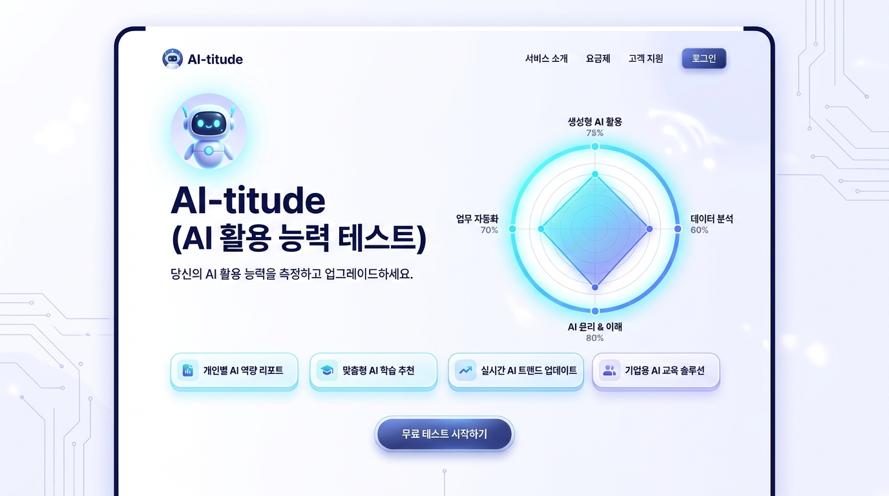

# 🤖 AI-titude (AI 활용 레벨 테스트)

> **"내 AI 활용법은 '능숙한 비서 부리기'일까, 아니면 그냥 '고급 검색창' 수준일까?"**  
> 대학생과 직장인을 위한 실전 공감 100% 인터랙티브 AI 활용 유형 테스트 웹앱입니다.

### 🌐 [👉 배포 사이트 바로가기 (Live Demo): https://aititude.vercel.app/](https://aititude.vercel.app/)

[](https://aititude.vercel.app/)
[](https://github.com/cosohotmas/ai_titude.git)
[](https://react.dev/)
[](https://www.typescriptlang.org/)
[](https://vitejs.dev/)
[](https://tailwindcss.com/)
[](https://motion.dev/)
[](https://opensource.org/licenses/MIT)

---

## 🖥️ 서비스 미리보기 (Preview)

[](https://aititude.vercel.app/)  
> 🔗 **[https://aititude.vercel.app/](https://aititude.vercel.app/)**  
> *(위 이미지를 클릭하면 실제 배포된 테스트 페이지로 바로 연결됩니다.)*

---

## 📌 프로젝트 소개 (About Project)

생성형 AI(ChatGPT, Claude, Gemini, Midjourney 등)가 일상과 업무의 기본 도구가 된 시대,  
사람들은 자신이 **"AI를 얼마나 제대로, 효율적으로 활용하고 있는지"** 끊임없이 궁금해합니다.

**AI-titude**는 기획서 작성, 거래처 이메일, 팩트체크, 최신 툴 탐색 등 직장인과 대학생이 자주 겪는 현실적인 8가지 시나리오를 바탕으로 개인의 AI 활용 태도와 역량을 입체적으로 분석하고, 개성 넘치는 페르소나로 진단해주는 반응형 웹 애플리케이션입니다.

- **배포 URL:** [https://aititude.vercel.app/](https://aititude.vercel.app/)
- **GitHub 저장소:** [https://github.com/cosohotmas/ai_titude.git](https://github.com/cosohotmas/ai_titude.git)

---

## ✨ 핵심 기능 (Key Features)

### 1. 🤖 감정 반응형 애니메이션 아바타 ('아이봇')
- 질문마다 생각하고, 놀라고, 호기심을 갖고, 데이터를 스캔하는 벡터 애니메이션 캐릭터가 친근하게 말풍선으로 테스트를 안내합니다.
- 결과 화면에서는 진단된 유형에 맞는 고유 코스튬(디렉터 안경, 닌자 고글, 탐정 돋보기 등)으로 변신합니다.

### 2. 🎯 현실 공감 100% 8대 시나리오 질문
- **기획 & 초안 작성:** 내일 아침까지 시장 조사 보고서를 내야 할 때
- **프롬프트 교정:** AI가 말귀를 못 알아들었을 때의 대처법
- **팩트체크 & 할루시네이션:** 그럴싸한 거짓 통계를 발견했을 때
- **비즈니스 이메일:** 까다로운 거래처에 정중하지만 단호한 거절 답장을 쓸 때
- **신규 툴 적응:** SNS에서 화제가 된 최신 AI 툴을 접했을 때
- **데이터 분석:** 100페이지 방대한 자료와 엑셀을 마주했을 때
- **아이디어 발산:** 오후 3시, 기획 아이디어가 막혔을 때
- **미래 경쟁력:** 전사 AI 의무화 시대 나의 생존 포지션

### 3. 📊 4대 역량 다각도 시각화 (0~100점)
사용자의 답변 패턴을 바탕으로 4개 핵심 영역을 정밀하게 점수화합니다:
- **🎯 프롬프트 디렉팅력:** 역할(Role), 제약, 형식을 정교하게 설계하는 지시력
- **⚡ 워크플로우 생산성:** 불필요한 반복 노동을 줄이고 칼퇴를 이끄는 시간 단축력
- **🛡️ 비판적 검증력:** 거짓 정보(할루시네이션)를 꿰뚫어 보는 팩트체크력
- **🚀 툴 스택 확장성:** 텍스트를 넘어 멀티모달과 최신 도구를 엮어 쓰는 확장력
- **SVG 기반 반응형 레이더 차트**와 **컬러풀한 진행 바(Progress Bar)**로 한눈에 역량 밸런스를 확인합니다.

### 4. 🎭 6대 AI 페르소나 매칭
좋고 나쁨이 아닌, 각자의 업무 스타일과 매력이 담긴 6가지 캐릭터를 도출합니다:
1. **AI 부사수 쥐잡듯이 잡는 ‘깐깐한 총괄 디렉터’ 🎩**  
   *“모호한 지시는 모호한 재앙을 낳을 뿐! 배경 설명부터 말투까지 칼같이 정해주는 프로 지시러”*
2. **3초 만에 복붙하고 사라지는 ‘칼퇴의 지배자’ ⚡**  
   *“인간의 노동은 최소화하고 퇴근 시간은 최대화하는 실속형 스피드 레이서”*
3. **AI 말은 콩으로 메주를 쑨대도 안 믿는 ‘의심암귀 감찰관’ 🔍**  
   *“AI의 거짓말(할루시네이션)을 귀신같이 잡아내는 인간 필터링 머신”*
4. **신상 툴만 보면 일단 가입부터 하는 ‘장비빨 툴 유목민’ 🚀**  
   *“PPT, 코딩, 이미지까지 계정만 10개 넘는 최신 트렌드 안테나”*
5. **AI에게도 깍듯하게 인사하는 ‘과몰입 소통러’ ☕**  
   *“소회의실에서 AI와 1:1 티타임 가지며 아이디어를 꽃피우는 브레인스토머”*
6. **자판기처럼 딱 필요한 것만 뽑아먹는 ‘미니멀리스트 실속파’ 🎯**  
   *“기교 없이 본론만 던져 80%의 효율을 챙기는 쿨한 가성비 장인”*

### 5. 🤝 동료 유형 궁합 & 액션 플랜
- **환상의 듀오**와 **환장의 콤비** 매칭으로 동료들과 결과를 공유하고 대화할 재미 제공
- 각 유형별 맞춤형 **핵심 강점**, **주의할 점**, **레벨업을 위한 추천 행동 3개** 수록

### 6. 📱 모바일 & PC 완벽 반응형 + 소셜 바이럴 기능
- 모바일 한 손 터치에 최적화된 큼직한 선택 카드 & PC 키보드 1~4 단축키 지원
- **친구에게 공유하기 (Web Share API 연동)**
- **링크 복사하기 (클립보드 자동 복사 + 토스트 알림)**
- **결과 축하 컨페티(폭죽) 파티클 연출**

---

## 🛠️ 기술 스택 (Tech Stack)

| 구분 | 기술 / 라이브러리 |
|---|---|
| **배포 환경 (Hosting)** | [Vercel](https://vercel.com/) ([https://aititude.vercel.app/](https://aititude.vercel.app/)) |
| **Framework** | [React 19](https://react.dev/) + [Vite 8](https://vitejs.dev/) |
| **Language** | [TypeScript](https://www.typescriptlang.org/) |
| **Styling** | [Tailwind CSS v4](https://tailwindcss.com/) |
| **Animation** | [Motion (Framer Motion v12)](https://motion.dev/) |
| **Icons** | [Lucide React](https://lucide.dev/) |
| **Effects** | [Canvas Confetti](https://www.npmjs.com/package/canvas-confetti) |

---

## 📂 프로젝트 구조 (Directory Structure)

```bash
ai_titude/
├── preview.jpg                 # README 및 배포 프리뷰 이미지
├── index.html                  # HTML 엔트리 포인트 (SEO 메타태그 설정)
├── metadata.json               # 앱 메타데이터
├── package.json                # 프로젝트 의존성 및 스크립트
├── tsconfig.json               # 타입스크립트 환경설정
├── vite.config.ts              # Vite 빌드 설정
└── src/
    ├── App.tsx                 # 메인 화면 전환 상태 머신 (Start/Quiz/Analyzing/Result)
    ├── main.tsx                # React Root 마운트
    ├── index.css               # Tailwind CSS v4 스타일링
    ├── components/
    │   ├── CharacterAvatar.tsx # 표정 및 기분 상태별 SVG 벡터 애니메이션 아바타
    │   ├── QuestionCard.tsx    # 1문항 카드, 진행률 바, 시나리오 선택지 컴포넌트
    │   ├── RadarChart.tsx      # 4축 SVG 레이더 다각형 차트 & 역량 점수 바
    │   └── ResultView.tsx      # 결과 리포트, 궁합, 추천 행동, 공유/복사 컴포넌트
    └── data/
        └── testData.ts         # 8개 문항, 4대 측정 영역, 6대 결과 유형 마스터 데이터
```

---

## 🚀 빠른 시작 (Getting Started)

### 1. 레포지토리 클론 (Clone)

```bash
git clone https://github.com/cosohotmas/ai_titude.git
cd ai_titude
```

### 2. 패키지 설치 (Install Dependencies)

```bash
npm install
```

### 3. 로컬 개발 서버 실행 (Run Dev Server)

```bash
npm run dev
```

브라우저에서 `http://localhost:3000` (또는 콘솔에 표시된 로컬 포트)으로 접속합니다.

### 4. 프로덕션 빌드 (Build for Production)

```bash
npm run build
```

---

## 💡 점수 계산 알고리즘 (Scoring Algorithm)

- 8개 문항의 각 선택지는 4개 축(`prompting`, `productivity`, `critical`, `toolStack`)에 가중치를 부여합니다.
- 총점을 기반으로 0~100점 척도로 정규화합니다.
- 계산된 사용자의 4차원 좌표와 6대 페르소나의 이상적 역량 벡터 간의 **유클리드 거리(Euclidean Distance)**를 측정하여 가장 근접한 최적의 페르소나를 매칭합니다.

---

## 📄 라이선스 (License)

This project is licensed under the **MIT License**.  
자유롭게 포크하여 자신만의 유형 테스트나 사내 교육용 도구로 커스텀하실 수 있습니다.
